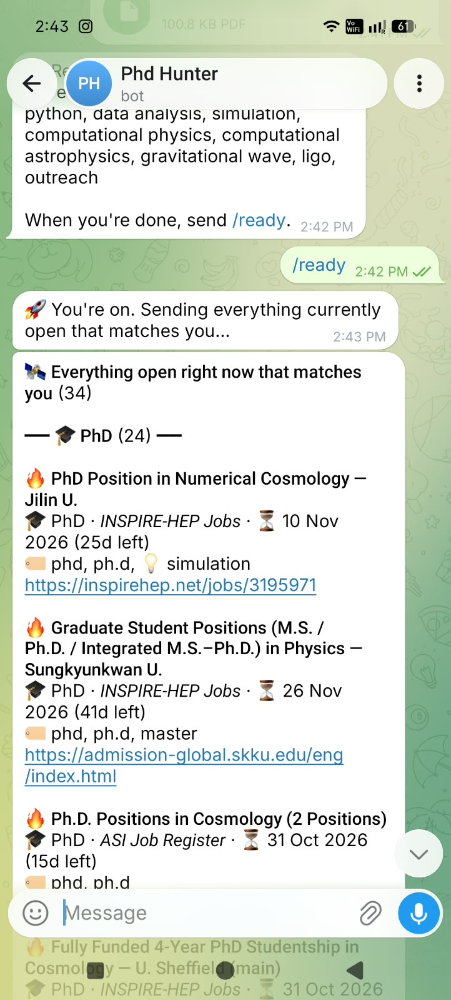
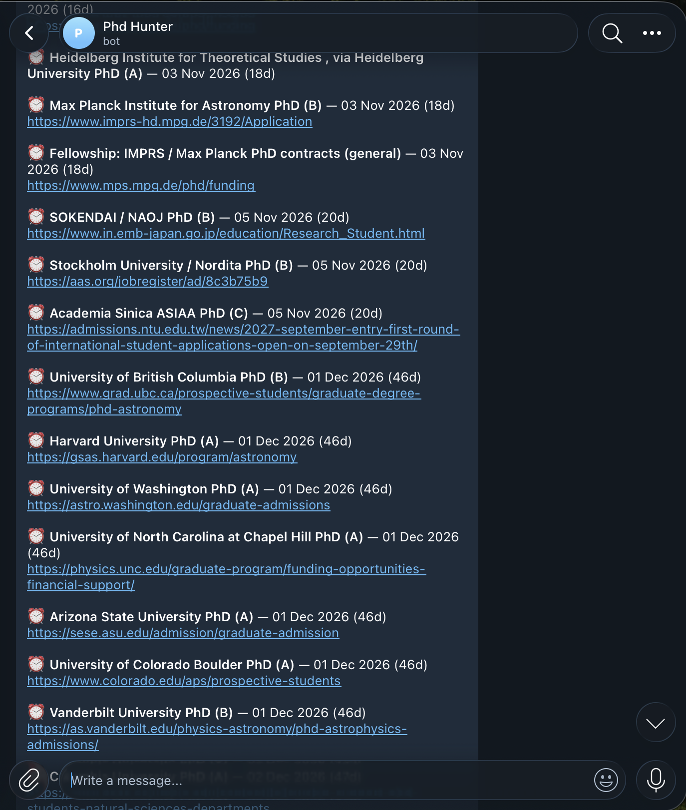
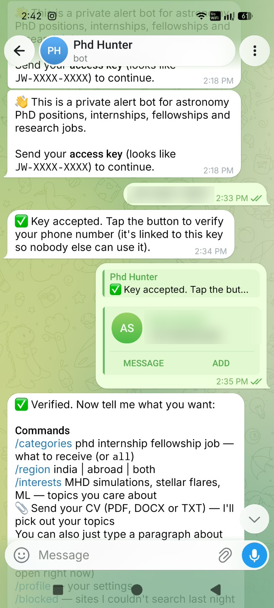
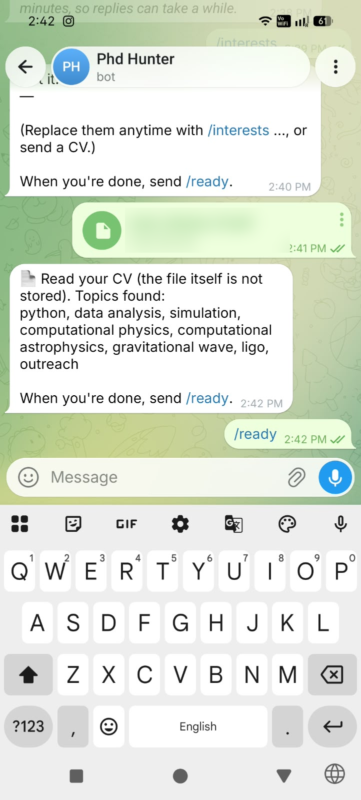
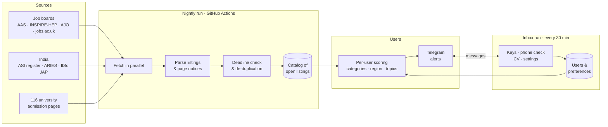

# 🛰 Astro JobWatch

**A Telegram bot that finds astronomy PhD positions, internships, fellowships
and research jobs every night — and sends each user only what matches them.**

> Source code is private. This page describes what the system does and how it
> is designed.

---

## Why I built it

Openings for an astronomy PhD are scattered across dozens of job boards,
society registers and individual department pages, each with its own format
and deadline conventions. Checking them by hand every week is slow and it is
easy to miss a call that closes in ten days. Astro JobWatch checks them all
every night and sends a short, ranked Telegram message — only with things
that are still open and have never been sent before.

  

## What it does

- **Searches ~150 sources nightly** — international job boards, the
  Astronomical Society of India register, Indian institute admission pages,
  and admission / scholarship pages of 116 target universities.
- **Ranks every listing** by position level (PhD, internship, fellowship,
  JRF / research job), field, and the user's own research topics. Postdoc and
  faculty posts are filtered out for student users.
- **Understands deadlines** — parses dates written in many formats, drops
  listings whose deadline has passed, and shows days left on each alert.
- **Never repeats itself** — the same opening found on two boards is sent
  once; each user is only sent what they haven't seen.
- **Watches plain web pages** — for department pages without job lists, it
  reports only *new* lines that mention admissions, calls or deadlines,
  instead of noisy "page changed" alerts.
- **Deadline reminders** 30, 14, 7 and 2 days before tracked deadlines.

  

- **Transparent about gaps** — every message lists the sites that could not
  be searched that night (many university sites block automated visitors),
  so nothing is silently missed.

## How to use it

Access is invite-only, so the first step is a key from the admin.

**1 · Join with your key.** Open the bot, press **Start**, paste the key
(`JW-XXXX-XXXX`), then tap **Share my phone number** to verify it's you.

**2 · Tell it what you want.** Send your CV, or type a few lines about your
interests. Pick categories and region with `/categories` and `/region`.

**3 · Send `/ready`.** You immediately get every opening that is open right
now and matches you — then, every night, only the new ones.

<table>
  <tr>
    <td align="center"> 1 · key accepted, phone verified</td>
    <td align="center"> 2 · topics read from a CV</td>
    <td align="center"> 3 · open positions, ranked</td>
  </tr>
</table>

| Command | What it does |
|---|---|
| `/categories phd internship fellowship job` | choose what to receive (or `all`) |
| `/region india \| abroad \| both` | where |
| `/interests …` | topics you care about (or just type a paragraph) |
| 📎 send a CV | topics are extracted automatically |
| `/ready` | start alerts |
| `/profile` · `/pause` · `/resume` | your settings |
| `/blocked` | sites that couldn't be searched last night |

## Personalised for each user

Each person chooses what they receive:

| Setting | Example |
|---|---|
| Categories | 🎓 PhD · 🧪 Internship · 🏅 Fellowship · 💼 Job |
| Region | India, abroad, or both |
| Interests | free text — *"MHD simulations, stellar flares, machine learning"* |
| CV | upload a PDF/DOCX; research topics and skills are extracted from it |

Listings that mention a user's topics rank higher and are tagged so the
reason for the match is visible. The CV file itself is never stored — only
the list of topics extracted from it.

## Invite-only access

- The admin generates **one-time access keys** with an expiry date.
- A key locks to the **Telegram account** that redeems it, and the user must
  **verify their own phone number** — a key cannot be passed on.
- Wrong or reused keys are refused and reported to the admin; repeated
  failures are ignored.
- Expired users are notified once and can continue with a new key.

## How it works

- **Nightly run** — fetches every source in parallel, parses listing tables,
  RSS feeds, a JSON API and free-form pages, then keeps a catalog of what is
  currently open.
- **Delivery** — each user's matches are scored against their own profile and
  sent grouped by category, best first.
- **Inbox run** — handles new users, key redemption, phone verification, CV
  uploads and settings.
- **State** — users, sent history and the open-listing catalog are stored as
  versioned JSON, so every change is auditable.

## Built with

Python · Telegram Bot API · GitHub Actions · BeautifulSoup · feedparser ·
pypdf · curl_cffi · YAML configuration

## Access

The bot is private and invite-only. For access or questions:
**connect@arpitmann.com** · [arpitmann.com](https://arpitmann.com)

---

© 2026 Arpit Mann. All rights reserved. See [LICENSE](LICENSE).
